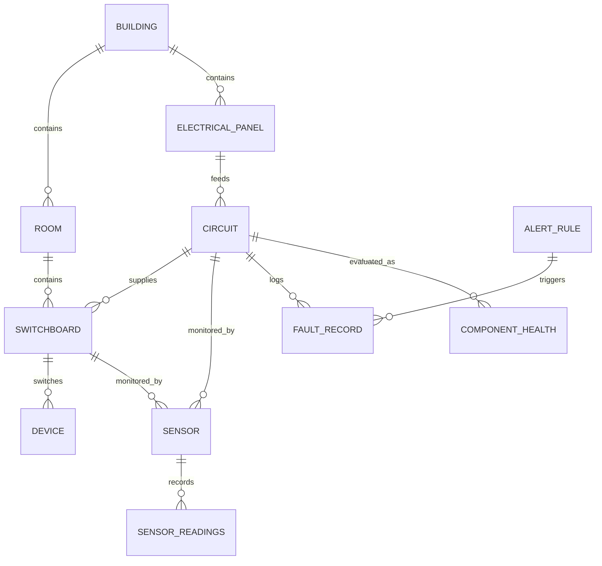
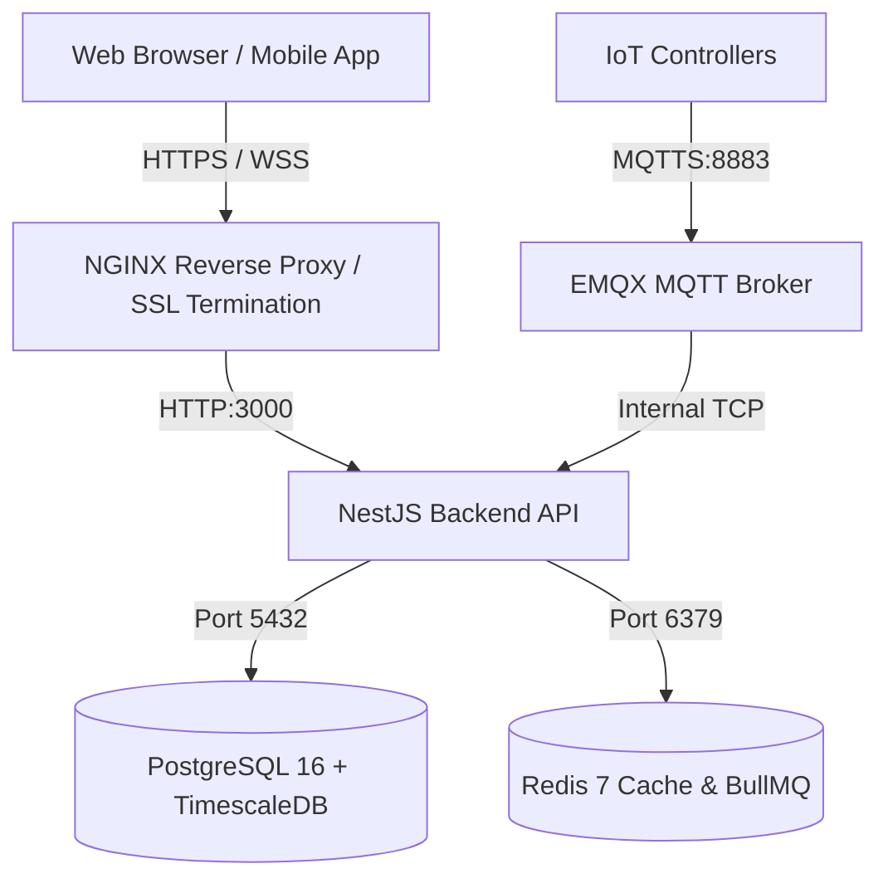

# AI-Powered Smart Electrical Monitoring and Home Automation System
## Complete System Technical Architecture & Design Document (Task 1 Blueprint)

> **Document Version:** 1.0.0  
> **Status:** APPROVED BASELINE  
> **Target System:** AI-Powered IoT Electrical Monitoring, Fault Detection, Predictive Maintenance & Smart Home Automation Platform  
> **Author:** Senior IoT & Electrical Systems Architect, AI/ML Engineer, Principal Full-Stack Developer  

---

## Executive Summary & Core Engineering Philosophy

This document defines the comprehensive architecture and engineering blueprint for transforming the anomaly detection platform into a carrier-grade **AI-Powered Smart Electrical Monitoring, Fault Detection, Predictive Maintenance, and Home Automation Platform**.

### Mandatory Safety and Design Principles (Master Instruction)
1. **Physical Safety Supremacy:** Software and AI **MUST NEVER** replace standard thermal-magnetic Circuit Breakers (MCBs), Residual Current Devices (RCD/RCCB), or Arc Fault Detection Devices (AFDDs). Electromechanical protective hardware independently handles instantaneous short-circuits and human shock protection.
2. **Software Boundaries:** Ordinary software actuation is strictly reserved for operational switching (turning lights/appliances ON/OFF), scheduled load shedding, and user-initiated commands. Software never acts as an emergency circuit breaker.
3. **Sensor-Grounded Detection:** The AI cannot infer physical electrical faults without appropriate physical transducers (True RMS voltage, current transformers, residual leakage transformers, and thermal sensors).
4. **Configurable Rule Engine:** Hardcoded thresholds are prohibited; dynamic multi-variable rules with hysteresis, debounce, and time-over-threshold must be used.
5. **Explainable AI:** Any AI/ML anomaly detection or Remaining Useful Life (RUL) estimation must provide physical root-cause explanations (e.g. "Simultaneous 12% voltage drop and 35% current surge with high-frequency noise suggests contact arcing or loose terminal block").

---

## 1. Complete System Architecture

The platform follows a resilient 7-tier distributed architecture spanning edge hardware, communication broker, stream ingestion, persistence, analytical inference, and interactive clients:

```
[ Tier 1: Physical Electrical Layer ]
   Mains Feed (1-Phase / 3-Phase) -> MCB/RCCB -> Distribution Busbar -> Branch Circuits -> Switchboards -> Appliances
   Sensors: Split-Core CTs (Current) | ZMPT101B / ADE7953 (Voltage) | DS18B20/NTC (Temp) | ZCT (Leakage mA)
                                       │
                                       ▼
[ Tier 2: Edge IoT Controller Layer (ESP32-S3 / Industrial Gateway) ]
   - High-speed ADC sampling (True RMS calculation, active/reactive power, power factor)
   - Local safety interlocks & hardware watchdog timer (WDT)
   - MQTT TLS Client with local SPIFFS offline buffering
                                       │
                                       ▼ (MQTTS Port 8883 / TLS 1.3)
[ Tier 3: IoT Communication & Broker Layer (EMQX / Mosquitto) ]
   - Topic hierarchy: home/{id}/panel/{id}/circuit/{id}/telemetry
   - Mutual TLS / Token authentication, QoS 0 (high-freq telemetry), QoS 1 (alerts/commands)
                                       │
                                       ▼
[ Tier 4: Backend Ingestion & Orchestration Layer (NestJS) ]
   - MqttModule: Ingestion consumer, schema validation, CRC check
   - TelemetryStreamService: In-memory sliding window buffer via Redis
   - WebSocket Gateway: Socket.io real-time streaming to dashboards
   - AutomationModule: Relay command scheduler, scene manager
                                       │
                                       ▼
[ Tier 5: AI & Analytical Intelligence Layer ]
   - Edge/Stream Filter: Z-Score & Moving Average Spike Detector
   - Multi-variate Detector: Isolation Forest, One-Class SVM, Autoencoder (TFJS)
   - Degradation & RUL Engine: Component Health Index (0-100%), Weibull hazard rate
   - Explainability Engine: Knowledge-base symptom-to-cause mapping
                                       │
                                       ▼
[ Tier 6: Multi-Model Persistence Layer (PostgreSQL / TimescaleDB + Redis) ]
   - TimescaleDB Hypertables: High-frequency telemetry (voltage, current, power, temp, leakage)
   - Relational Tables: Users, Homes, Rooms, Panels, Switchboards, Circuits, Devices, Audit Logs
   - Redis: Real-time telemetry cache, BullMQ job queues, pub/sub for clustered web sockets
                                       │
                                       ▼
[ Tier 7: Presentation & Application Layer ]
   - Web Dashboard: React 18, Vite, Tailwind CSS, Recharts, Lucide Icons
   - Mobile Interface: Responsive PWA / React Native client for iOS & Android
```

---

## 2. Hardware Architecture & Electrical Sensor Integration

### 2.1 Hardware-Dependent vs. Software-Only Feature Demarcation

| Feature | Classification | Hardware Prerequisites | Software Responsibility |
|---|---|---|---|
| **Short-Circuit Trip (<10ms)** | Hardware-Only | Thermal-magnetic MCB (Type B/C) | Record trip event if telemetry survives; NEVER control trip |
| **Earth Leakage Protection (<30ms)** | Hardware-Only | Type A/B RCCB (30mA residual) | Monitor leakage trend in mA; alert before 30mA trip |
| **True RMS V, I, P, Q, PF** | Hardware-Dependent | Split-Core CT (SCT-013), ADE7953/PZEM IC | Aggregate, calibrate, and compute energy metrics |
| **Overheating Detection** | Hardware-Dependent | DS18B20 or NTC 10K thermistor on busbars | Compare against thermal gradient and ambient temperature |
| **Loose Terminal Arcing** | Hardware-Dependent | High-frequency sampling CT / AFDD sensor | Detect cycle-to-cycle current distortion and crest factor |
| **Appliance Power Scheduling** | Software-Only | Opto-isolated Latching Relay / Contactor | Execute cron schedules, user timers, and room scenes |
| **Predictive Component Health** | Software-Only | Continuous telemetry history | Calculate wear index, Arrhenius thermal stress, RUL |

### 2.2 Transducer Specifications & Measurement Points
1. **Current Measurement:**
   - *Mains Feeder:* Split-core Current Transformer SCT-013-000 (100A / 50mA secondary), Burden resistor 33Ω for 3.3V ADC.
   - *Branch Circuits & Switchboards:* SCT-006 (20A / 25mA) or Hall-effect ACS712 / TMCS1100 for compact enclosures.
2. **Voltage Measurement:**
   - Isolated ZMPT101B module or dedicated ADE7953 / HLW8032 energy IC connected through high-voltage isolation barrier (>3.75kV RMS isolation).
3. **Residual/Leakage Current Measurement:**
   - Zero-Phase Current Transformer (ZCT) encompassing Phase + Neutral conductors, measuring differential leakage current (range: 1mA – 100mA).
4. **Thermal Monitoring:**
   - DS18B20 digital 1-Wire sensors (operating range: -55°C to +125°C, ±0.5°C accuracy) affixed with thermal epoxy to busbar junctions, neutral lugs, and relay terminals.
5. **Actuation:**
   - 16A/25A bistable magnetic latching relays (zero standby power, no coil heating) with MOV (Metal Oxide Varistor) surge suppressors and RC snubber circuits for inductive motor loads.

---

## 3. Software Architecture (NestJS Backend Modular Design)

The backend in `Anomaly-Detection-BE-` is architected with clean Domain-Driven Design (DDD) principles:

```
src/
├── app.module.ts                       # Root application module
├── config/                             # Environment validation & dynamic configuration
├── auth/                               # JWT, bcrypt, RBAC guards, device tokens
├── users/                              # User entity, roles (Admin, Homeowner, Technician)
├── topology/                           # Hierarchical infrastructure management
│   ├── entities/                       # Building, Floor, Room, Panel, Switchboard, Circuit, Device
│   ├── dto/                            # Create/Update DTOs with class-validator
│   └── topology.service.ts             # CRUD and topological relationship traversals
├── iot/                                # IoT communication and device registry
│   ├── controllers.entity.ts           # IoT micro-controllers (ESP32)
│   ├── sensors.entity.ts               # Sensor transducers and calibration coefficients
│   ├── mqtt.service.ts                 # MQTT client subscription and message handler
│   └── mqtt.gateway.ts                 # Hardware heartbeat and status monitor
├── telemetry/                          # Time-series ingestion and aggregation
│   ├── telemetry.entity.ts             # Hypertable entity for raw sensor readings
│   ├── telemetry.service.ts            # High-throughput batch insertion, Redis caching
│   └── telemetry.controller.ts         # REST query endpoints for time-range series
├── automation/                         # Home automation and smart actuation
│   ├── automation.entity.ts            # Schedules, Scenes, and Trigger actions
│   ├── automation.service.ts           # Relay state dispatcher, conflict resolver
│   └── automation.controller.ts        # REST endpoints for switch toggle and scenes
├── rules-engine/                       # Dynamic alert rule evaluation
│   ├── alert-rule.entity.ts            # Parameter, operator, threshold, duration, hysteresis
│   └── rules-evaluator.service.ts      # Stream evaluator with sliding debounce
├── detection/                          # AI & ML Electrical Fault Detection
│   ├── detectors/                      # ZScore, Isolation Forest, OCSVM, Autoencoder, ArcingDetector
│   ├── fault-record.entity.ts          # Detected faults, severity, parameter snapshots
│   └── fault-detection.service.ts      # Multi-stage detection pipeline
├── predictive/                         # Predictive Maintenance & RUL
│   ├── component-health.entity.ts      # Health index (0-100), degradation score, RUL days
│   ├── maintenance-record.entity.ts    # Maintenance history, technician logs
│   └── predictive-maintenance.service.ts # Arrhenius thermal degradation + Weibull estimator
└── live/                               # Socket.io real-time broadcast gateway
```

---

## 4. Database Design & Entity-Relationship Model

The PostgreSQL / TimescaleDB schema integrates structured topology with high-performance time-series partitioning:



### Key Relational Entities:
1. **`buildings` / `homes`:** ID, Name, Address, OwnerId, MainsSupplyType (`1-PHASE`, `3-PHASE`), GridNominalVoltage (230V / 120V), CreatedAt.
2. **`rooms`:** ID, BuildingId, Name, RoomType (`LIVING`, `KITCHEN`, `BEDROOM`, `UTILITY`, `GARAGE`), FloorNumber.
3. **`electrical_panels`:** ID, BuildingId, PanelName, Location, RatedAmperage (e.g. 63A, 100A), BusbarMaterial (`COPPER`, `ALUMINUM`), InstallationDate.
4. **`circuits`:** ID, PanelId, CircuitNumber, BreakerRatingAmps, WireGaugeMm2 (`1.5mm`, `2.5mm`, `4.0mm`, `6.0mm`), WireType, CircuitCategory (`LIGHTING`, `SOCKETS`, `HVAC`, `HEAVY_APPLIANCE`).
5. **`switchboards`:** ID, RoomId, CircuitId, BoardName, MaxLoadWatts, ControllerId.
6. **`devices` / `appliances`:** ID, SwitchboardId, RelayChannel (1-8), Name, Category (`LIGHT`, `FAN`, `REFRIGERATOR`, `AC`, `HEATER`, `SOCKET`), RatedWatts, State (`ON`, `OFF`), IsDimmable.
7. **`sensors`:** ID, ControllerId, TargetType (`CIRCUIT`, `SWITCHBOARD`, `PANEL`), TargetId, SensorType (`CURRENT_CT`, `VOLTAGE`, `TEMPERATURE`, `LEAKAGE`), CalibrationMultiplier, CalibrationOffset.
8. **`sensor_readings` (Hypertable partitioned by time):**
   - `timestamp` (TIMESTAMPTZ NOT NULL)
   - `sensor_id` (UUID)
   - `circuit_id` (UUID)
   - `voltage_rms` (FLOAT)
   - `current_rms` (FLOAT)
   - `active_power_watts` (FLOAT)
   - `reactive_power_var` (FLOAT)
   - `power_factor` (FLOAT)
   - `frequency_hz` (FLOAT)
   - `temperature_celsius` (FLOAT)
   - `leakage_current_ma` (FLOAT)
9. **`component_health`:** ID, EntityType (`CIRCUIT_WIRING`, `SWITCH_RELAY`, `BREAKER`, `TERMINAL_LUG`), EntityId, HealthScore (0–100), FailureRisk (`LOW`, `MEDIUM`, `HIGH`, `CRITICAL`), EstimatedRulDays, ThermalStressAccumulated, CyclesSwitched, LastEvaluatedAt.
10. **`alert_rules`:** ID, Name, TargetType, TargetId, Parameter (`CURRENT`, `VOLTAGE`, `TEMP`, `LEAKAGE`, `POWER_FACTOR`), Condition (`GT`, `LT`, `BETWEEN`), ThresholdValue, DurationSeconds, Hysteresis, Severity (`INFO`, `WARNING`, `CRITICAL`), IsEnabled.

---

## 5. API Structure & Endpoint Specifications

### 5.1 RESTful Endpoints (`/api/v1`)

#### Topology & Device Management:
- `GET /api/v1/topology/homes` — List accessible properties.
- `GET /api/v1/topology/homes/:id/tree` — Complete hierarchy (Home -> Rooms -> Switchboards -> Devices & Circuits).
- `POST /api/v1/topology/devices/:id/toggle` — Actuate switch relay (`{ state: "ON" | "OFF" }`).
- `PUT /api/v1/topology/devices/:id/schedule` — Create or update appliance timer/schedule.

#### Telemetry & Energy Monitoring:
- `GET /api/v1/telemetry/live/:circuitId` — Latest instantaneous reading snapshot.
- `GET /api/v1/telemetry/history` — Query metrics within time range (`start`, `end`, `resolution: 1m | 15m | 1h`).
- `GET /api/v1/telemetry/energy-consumption` — Aggregated kWh usage grouped by room/appliance.

#### Fault Detection & Safety Alerts:
- `GET /api/v1/faults/active` — List unresolved electrical faults with severity and root-cause summary.
- `POST /api/v1/faults/:id/acknowledge` — Technician or homeowner acknowledges fault alert.
- `GET /api/v1/faults/history` — Historical fault log with audit trail.

#### AI Predictive Maintenance:
- `GET /api/v1/predictive/health-overview` — Health scores across all circuits, switchboards, and wiring.
- `GET /api/v1/predictive/component/:id/rul` — Remaining Useful Life projection, degradation curve, and maintenance recommendations.
- `POST /api/v1/predictive/maintenance-logs` — Log maintenance action (e.g. screw retorqued, wire replaced).

#### Configurable Rules Engine:
- `GET /api/v1/rules` — List active user and system alert rules.
- `POST /api/v1/rules` — Create new dynamic threshold rule.
- `POST /api/v1/rules/dry-run` — Evaluate rule against historical data before deployment.

### 5.2 Real-time WebSocket Protocol (Socket.io)
- **Namespaces:** `/telemetry`, `/alerts`
- **Client Emits:** `subscribe { circuitId: "..." }`, `unsubscribe { circuitId: "..." }`
- **Server Broadcasts:**
  - `telemetry:update` — Frequency: 1 Hz live metrics stream.
  - `alert:triggered` — Instantaneous push on threshold or ML anomaly detection.
  - `device:state_changed` — Synchronized broadcast across all mobile/web sessions.

---

## 6. IoT Communication Architecture (MQTT & Security)

### 6.1 Topic Hierarchy
```
telemetry/v1/{homeId}/{controllerId}/reading     # Periodic batch readings (QoS 0)
telemetry/v1/{homeId}/{controllerId}/event       # Spontaneous threshold/event alerts (QoS 1)
status/v1/{homeId}/{controllerId}                # LWT (Last Will & Testament: online/offline)
command/v1/{homeId}/{controllerId}/set           # Cloud-to-Edge actuator commands (QoS 1)
command/v1/{homeId}/{controllerId}/ack           # Edge-to-Cloud command confirmation (QoS 1)
config/v1/{homeId}/{controllerId}/update         # OTA config and parameter thresholds
```

### 6.2 Data Payloads
- **Compact JSON Frame (Telemetry):**
```json
{
  "ts": 1793440000,
  "cid": "ctrl_esp32_01",
  "data": [
    {
      "ckt": "ckt_living_ac",
      "v": 231.4,
      "i": 8.75,
      "p": 1980.2,
      "pf": 0.98,
      "f": 50.02,
      "t": 38.5,
      "leak_ma": 2.1
    }
  ]
}
```

---

## 7. AI/ML Architecture & Fault Detection Engine

### 7.1 Multi-Stage Analytical Pipeline
The AI architecture uses a tiered design to achieve sub-second fault notification while maintaining deep predictive intelligence:

```
Telemetry Stream (1 Hz - 10 Hz)
       │
       ├── Tier 1: Real-time Rule & Z-Score Screening (<50ms)
       │     ├── IEC / NEC Hard Limits (V < 198V or V > 253V, I > 125% In)
       │     ├── Sliding Window Z-Score (Sudden standard deviation surge)
       │     └── Overheating Gradient (dT/dt > 2.0 °C / min)
       │
       ├── Tier 2: Unsupervised Multi-Variate Anomaly Detection (<500ms)
       │     ├── Isolation Forest & One-Class SVM on [V, I, P, PF, T, Leakage]
       │     └── Autoencoder Reconstruction Error (TFJS model trained on normal profile)
       │
       └── Tier 3: Predictive Degradation & Health Scoring (Batch / Hourly)
             ├── Arrhenius Thermal Aging Accumulator
             ├── Weibull RUL Hazard Function
             └── Grounded Diagnostic Explanation Engine
```

### 7.2 Deterministic Electrical Hard Limits (Standard Compliant)
- **Overcurrent:** Continuous $I > 1.0 \times I_n$ triggers warning; $I > 1.25 \times I_n$ for $> 60\text{s}$ triggers critical overload.
- **Under-Voltage:** $V < 0.9 \times V_{nominal}$ (e.g. $<207\text{V}$ for $230\text{V}$ nominal).
- **Over-Voltage:** $V > 1.1 \times V_{nominal}$ (e.g. $>253\text{V}$ for $230\text{V}$ nominal).
- **Terminal Temperature:** $T > 70^\circ\text{C}$ (typical PVC insulation threshold) or $\Delta T > 25^\circ\text{C}$ above ambient.
- **Leakage Current:** $I_{leak} > 15\text{mA}$ warning (approaching standard $30\text{mA}$ RCD trip).

---

## 8. Fault Detection & Diagnostic Catalog

| Fault Category | Physical Root Cause | Telemetry Signature | Detection Method |
|---|---|---|---|
| **Branch Overload** | Excessive appliances on single circuit | $I > I_n$, $V$ slight drop, $T$ gradual rise | Time-over-threshold + Moving Average |
| **Loose Terminal / Contact Arcing** | Poor screw torque, oxidized copper lug | High $I$ jitter, erratic $PF$, localized rapid $T$ spike, voltage notches | Spectral variance / Isolation Forest |
| **Neutral Degradation** | High neutral return resistance | Voltage unbalance, neutral conductor heating | Neutral-Earth voltage & phase symmetry check |
| **Wiring Insulation Breakdown** | Aging PVC, vermin bite, moisture ingress | Progressive increase in $I_{leak}$ (mA), low insulation resistance | ZCT Leakage trend + Z-Score |
| **Compressor / Motor Stall** | Locked motor rotor (AC or refrigerator) | $I$ surge to $4-6\times$ nominal with very low $PF$ (<0.4) for $>3\text{s}$ | Inrush persistence window filter |
| **Power Supply Degradation** | Failing capacitor in consumer electronics | Low $PF$, increased total harmonic distortion, high crest factor | Autoencoder reconstruction error |

---

## 9. Predictive Maintenance & Component Health Index Strategy

### 9.1 Component Health Index Formulation
The composite Health Index ($HI \in [0, 100]$) quantitatively grades every monitored electrical asset:

$$HI = 100 - \left( w_T \cdot S_{thermal} + w_L \cdot S_{load} + w_F \cdot S_{fluct} + w_A \cdot S_{age} + w_H \cdot S_{history} \right)$$

Where weights satisfy $\sum w = 1.0$:
- $S_{thermal}$ (Weight 0.35): Cumulative thermal exposure above baseline using Arrhenius thermal degradation law:
  $$\text{Aging Factor} = 2^{\frac{T_{measured} - T_{rated}}{10}}$$
- $S_{load}$ (Weight 0.25): Mean load factor relative to rated wire ampacity ($\bar{I} / I_{rated}$).
- $S_{fluct}$ (Weight 0.15): Voltage fluctuation and sag/surge count over last 30 days.
- $S_{age}$ (Weight 0.15): Calendar age relative to manufacturer design lifetime (typically 20 years for wiring, 10 years for breakers/relays).
- $S_{history}$ (Weight 0.10): Frequency of historical trip events and anomaly detections.

### 9.2 Maintenance Action Thresholds
- **$HI \ge 80$ (Optimal Health):** Normal operation; next routine inspection as scheduled.
- **$60 \le HI < 80$ (Good / Monitored):** Minor thermal or load stress noted. Increase monitoring frequency.
- **$40 \le HI < 60$ (Attention Required):** Preventive inspection recommended within 30 days. Inspect screw terminal torque and load balance.
- **$HI < 40$ (High Failure Risk):** High probability of thermal failure or unplanned tripping within 14 days. Immediate electrician dispatch recommended.

---

## 10. Security Architecture

1. **Edge Device Identity & Authentication:**
   - Unique per-device ECC X.509 certificates or cryptographically random tokens stored in ESP32 NVS encrypted partition.
   - Hardware secure boot enabled; JTAG debugging disabled in production.
2. **Transport Layer Security:**
   - All external communication encrypted via TLS 1.3 (HTTPS on port 443, MQTTS on port 8883, WSS on port 443).
3. **Application & API Security:**
   - JWT tokens with short lifespan (15 minutes) paired with secure HttpOnly refresh cookies.
   - Granular Role-Based Access Control (RBAC): `SUPER_ADMIN`, `PROPERTY_OWNER`, `RESIDENT`, `CERTIFIED_TECHNICIAN`.
   - Redis-backed rate limiting per IP and device ID (token bucket algorithm).
4. **Data Protection & Compliance:**
   - Sensitive audit logs and user credential hashes (bcrypt, cost factor 12).
   - AES-256 encryption at rest for database backups and sensitive configuration secrets.

---

## 11. Development Roadmap (Aligned with 8-Task Sequence)

```
[ Phase 1: Architectural Design & Requirements Baseline ] (Task 1 - Current)
   └── Deliverable: Comprehensive technical blueprint, safety demarcation, interface specs.

[ Phase 2: IoT Hardware & Sensor Integration Specs ] (Task 2)
   └── Deliverable: Transducer schematics, ADC calibration algorithms, local ESP32 firmware loop.

[ Phase 3: Backend Entities, Migrations & APIs ] (Task 3)
   └── Deliverable: NestJS TypeORM entities, TimescaleDB hypertables, REST endpoints, Swagger docs.

[ Phase 4: AI Electrical Fault Detection Engine ] (Task 4)
   └── Deliverable: Multi-model anomaly pipeline (Z-Score, Isolation Forest, Autoencoder, Arcing).

[ Phase 5: AI Predictive Electrical Maintenance ] (Task 5)
   └── Deliverable: Health Index engine, Arrhenius thermal aging accumulator, RUL Weibull predictor.

[ Phase 6: Smart Home Automation & Rule Engine ] (Task 6)
   └── Deliverable: Relay control dispatcher, cron scheduler, dynamic rule expression evaluator.

[ Phase 7: Web Dashboard & Mobile-Responsive UI ] (Task 7)
   └── Deliverable: React 18 / Tailwind UI, live energy gauges, room switchboards, interactive charts.

[ Phase 8: Testing, Telemetry Simulator & Docker Deployment ] (Task 8)
   └── Deliverable: Automated tests, realistic electrical fault simulator script, production docker-compose.
```

---

## 12. Testing Strategy

1. **Unit Testing:**
   - 100% coverage on core mathematical models: True RMS computation, power factor trigonometry, Z-Score, Arrhenius degradation, and rule evaluator AST.
2. **Integration Testing:**
   - Test NestJS controllers and services with Supertest and an in-memory/isolated PostgreSQL container.
   - Verify MQTT message ingestion and WebSocket notification dispatch under concurrent device connections.
3. **Electrical Fault Simulation Testing:**
   - Synthetic telemetry injector that simulates:
     - Normal domestic load cycle (morning peak, daytime lull, evening peak).
     - Overload step function ($I$ transitioning from 10A to 35A on a 20A breaker).
     - Contact arcing (microsecond random current dropouts with high variance).
     - Thermal runaway ($T$ climbing from 35°C to 85°C with $I^2R$ power).
4. **Resilience & Failover Testing:**
   - Network drop simulation: ESP32 buffers 500 readings locally, flushes upon reconnect without data loss.

---

## 13. Deployment Strategy & Containerization

The production environment is orchestrated via containerized microservices:



- **Docker Compose Configuration:**
  - `postgres`: PostgreSQL 16 with TimescaleDB extension and persistent volume storage.
  - `redis`: Redis 7 alpine with persistent AOF (Append-Only File) storage.
  - `emqx`: High-throughput clustered MQTT broker.
  - `api`: Multi-stage Docker build of `Anomaly-Detection-BE-`.
  - `web`: NGINX container serving optimized production build of `Anomaly-Detection`.

---

## 14. Estimated Infrastructure Requirements

### Small / Pilot Deployment (1 to 50 Homes, ~500 Circuits):
- **Server:** 2 vCPU, 4 GB RAM, 60 GB NVMe SSD.
- **Throughput:** ~500 readings/sec (aggregated at 1-sec edge intervals).
- **Network Bandwidth:** ~1.5 Mbps average ingress.

### Medium Commercial Deployment (500 to 2,000 Homes, ~20,000 Circuits):
- **Backend API:** 2 instances (each 2 vCPU, 4 GB RAM) behind load balancer.
- **Database:** Managed TimescaleDB instance (4 vCPU, 16 GB RAM, 500 GB NVMe).
- **MQTT Broker:** Clustered EMQX (2 nodes, 2 vCPU, 4 GB RAM).
- **Retention Policy:** Raw 1-second data retained for 30 days; automatically compressed into 15-minute rollups for 365 days; daily rollups indefinitely.

---

## Missing Requirements & Decisions Requiring User Approval

Before proceeding to Phase 2 (IoT Hardware Integration) and Phase 3 (Backend Implementation), the following architectural decisions are presented for user alignment:

1. **Electrical Supply Standard:**
   - *Option A:* Single-phase 230V / 50Hz (standard residential in India, Europe, UK).
   - *Option B:* Split-phase 120V/240V 60Hz (standard US/North America).
   - *Option C:* Universal support (dynamic configuration per home). *(Recommended)*
2. **Telemetry Ingestion Cadence:**
   - *Option A:* 1 Hz continuous live streaming from all circuits (rich analytics, higher database write volume). *(Recommended)*
   - *Option B:* Edge aggregation on ESP32 (send 10-second averages, with instantaneous push on anomaly detection).
3. **Mailing & Notification Channels:**
   - In-app WebSocket alerts + Push Notifications only, or integrated SMS/WhatsApp/Email notifications for critical hazards.

---
*End of Architectural Design Document (Task 1)*

