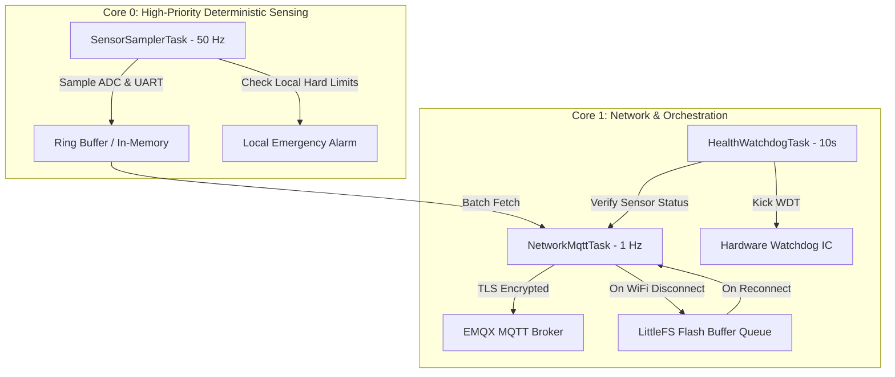

# IoT Hardware Integration & Electrical Sensor Interfacing Guide
## Technical Specification, Wiring Architecture, Firmware Design, and Calibration (Task 2 Blueprint)

> **Document Version:** 1.0.0  
> **Target Platform:** AI-Powered Smart Electrical Monitoring and Home Automation Platform  
> **Status:** APPROVED HARDWARE BASELINE  
> **Safety Compliance:** IEC 61010-1 (CAT III 300V / SELV), UL 94-V0 Enclosure Flame Rating  

---

## 1. Safety Supremacy & Electrical Isolation Principles

> [!CAUTION]
> **CRITICAL ELECTRICAL SAFETY MANDATE:**  
> 1. Never connect ESP32 microcontroller GPIO pins directly to AC mains (120V/230V/400V). Direct connection will cause instantaneous component destruction, fire hazard, and lethal electric shock.
> 2. All mains voltage and current measurements must pass through certified galvanic isolation barriers (>3.75 kV RMS isolation test voltage).
> 3. Microcontrollers, low-voltage sensors, and external communication lines must operate strictly within the **Safety Extra-Low Voltage (SELV)** domain (<30V AC / <60V DC).
> 4. Physical circuit protection (standard thermal-magnetic MCBs, RCCBs/RCDs) must remain electromechanically independent. The IoT system must NEVER replace or bypass certified circuit breakers.

---

## 2. Hardware Bill of Materials (BOM) & Sensor Specifications

| Subsystem | Component / Part Number | Description & Rating | Isolation & Interface |
|---|---|---|---|
| **Main Microcontroller** | ESP32-S3-WROOM-1-N16R8 | Dual-core 240 MHz, 16MB Flash, 8MB PSRAM, Hardware Crypto (AES-256, RSA) | SELV domain, 3.3V Logic |
| **Mains Voltage & Energy IC** | ADE7953 or HLW8032 / PZEM-004T v3.0 | True RMS Voltage (80–260V AC), Current (0–100A), Active Power, PF, Frequency | Optocoupler Isolated UART (3.75 kV RMS) |
| **Main Feeder Current Sensing** | SCT-013-000 | Split-core Current Transformer, 100A AC primary, 50mA secondary, linearity ±1% | Galvanically isolated magnetic coupling |
| **Branch Circuit Current Sensing** | SCT-006 / DL-CT08CL5 | Micro Split-core CT (20A / 25mA secondary) or PCB solid-core CT | Galvanically isolated magnetic coupling |
| **Differential Earth Leakage** | ZCT-25 or TA12-100 ZCT | Zero-Phase Current Transformer, differential leakage detection 1mA – 100mA | Galvanically isolated toroidal core |
| **Thermal Busbar Monitoring** | DS18B20 (Waterproof Stainless Probe) | Digital temperature sensor (-55°C to +125°C, ±0.5°C accuracy) | 1-Wire Bus with 4.7kΩ pull-up |
| **Breaker Trip Sensing** | Auxiliary Contact Module (e.g. Schneider OFS / ABB S2C-H6R) | Mechanically coupled dry-contact indicating MCB trip position | Opto-isolated Digital Input (PC817) |
| **Appliance Actuation** | Hongfa HFE10-1 / Omron G5Q | 16A / 250V AC bistable magnetic latching relay with zero static power dissipation | Opto-isolated ULN2803 driver + Snubber |
| **Auxiliary Power Supply** | Mean Well IRM-10-5 | Isolated AC-DC converter module (85–264V AC input, 5V DC 2A output) | 3 kV AC reinforced isolation |
| **Low-Dropout Voltage Regulator** | AMS1117-3.3 / TPS73733 | 5V DC to 3.3V DC 1A LDO with thermal overload shutdown | Low-noise analog supply rail |

---

## 3. Safe Low-Voltage Pinout & Interfacing Schematics (ESP32-S3)

```
                       +-----------------------------------+
                       |         ESP32-S3 Controller       |
                       |                                   |
[PZEM / ADE7953 UART]--| GPIO 18 (RXD2)      GPIO 17 (TXD2)|--[Opto-isolated UART TX]
[DS18B20 1-Wire Bus] --| GPIO 4  (Pull-up 4.7k to 3.3V)    |
[ZCT Leakage ADC]    --| GPIO 1  (ADC1_CH0 via 33Ω Burden) |
[CT Phase 1 ADC]     --| GPIO 2  (ADC1_CH1 via 33Ω Burden) |
[CT Phase 2 ADC]     --| GPIO 3  (ADC1_CH2 via 33Ω Burden) |
[Aux MCB Trip Input] --| GPIO 5  (Opto PC817 Input)        |
[Relay 1 Actuate]    --| GPIO 12 (ULN2803 Driver Pin 1)    |
[Relay 2 Actuate]    --| GPIO 13 (ULN2803 Driver Pin 2)    |
[Status RGB LED]     --| GPIO 38 (WS2812B NeoPixel)        |
[Hardware WDT Pin]   --| GPIO 21 (External Watchdog Reset) |
                       +-----------------------------------+
```

### Signal Conditioning Circuit for Analog Current Transformers (SCT-013)
Because AC current produces an alternating voltage across the burden resistor ($R_B = 33\,\Omega$):
1. **Mid-rail DC Bias:** A voltage divider ($10\,\text{k}\Omega / 10\,\text{k}\Omega$) across $3.3\,\text{V}$ and GND with a $10\,\mu\text{F}$ filter capacitor establishes a stable $1.65\,\text{V}$ DC virtual ground.
2. **Burden Resistor:** Connected directly across the CT secondary leads to convert secondary mA current into a safe AC voltage:
   $$V_{RMS} = I_{secondary} \times R_B = \left(\frac{I_{primary}}{2000}\right) \times 33\,\Omega$$
   For $100\,\text{A}$ primary: $V_{RMS} = 0.05\,\text{A} \times 33\,\Omega = 1.65\,\text{V}_{RMS}$ ($2.33\,\text{V}_{peak}$).
3. **Clamping Diodes:** Dual Schottky protection diodes (BAT54S) clamp transients to $-0.3\,\text{V}$ and $+3.6\,\text{V}$ to safeguard the ESP32 ADC.

---

## 4. Firmware Architecture (FreeRTOS Multi-Tasking)

The firmware is structured into three decoupled FreeRTOS tasks to ensure that high-frequency sensor sampling never blocks network communication or safety loops:



### FreeRTOS Tasks Specifications:
1. **`SensorSamplerTask` (Pinned to Core 0, Priority 5 - Highest):**
   - Cycles every $20\,\text{ms}$ ($50\,\text{Hz}$ / $60\,\text{Hz}$ power cycle sync).
   - Polls UART isolated energy meter (ADE7953 / PZEM-004T) for True RMS Voltage, Active Power, and Power Factor.
   - Performs oversampled ADC reads (64 samples per mains cycle) for analog CT and ZCT leakage sensors.
   - Computes moving standard deviation for cycle-to-cycle arcing detection.
   - Pushes timestamped sensor packet into circular RAM queue.

2. **`NetworkMqttTask` (Pinned to Core 1, Priority 3 - Normal):**
   - Manages Wi-Fi station connection with exponential backoff reconnect.
   - Establishes MQTTS connection over TLS 1.3 (Port 8883) using pre-provisioned device credentials.
   - Batches sensor packets and publishes to topic `telemetry/v1/{homeId}/{controllerId}/reading`.
   - Listens to command topic `command/v1/{homeId}/{controllerId}/set` and toggles latching relays.
   - Flushes offline readings from LittleFS on reconnection.

3. **`HealthWatchdogTask` (Pinned to Core 1, Priority 1 - Lowest):**
   - Monitors free heap space (detects memory fragmentation).
   - Verifies DS18B20 connectivity (flags disconnected sensor if temperature equals $-127^\circ\text{C}$ or $+85^\circ\text{C}$).
   - Kicks external hardware watchdog timer (TPL5010 / MAX6369) every 5 seconds. If the firmware hangs for $>10\,\text{s}$, the hardware watchdog resets the ESP32.

---

## 5. Offline Resilient Ring Buffer (LittleFS Storage)

When Wi-Fi or Internet connectivity drops, the controller must never discard sensor readings:

1. **In-Memory Ring Buffer:** 128 KB RAM buffer holds up to 600 reading frames (10 minutes of 1 Hz data).
2. **Flash Persistence (LittleFS):** If disconnection persists $> 10$ minutes, oldest entries spill over into an encrypted LittleFS flash file `offline_telemetry.bin`.
3. **Capacity:** 4 MB dedicated flash partition stores up to 28,800 telemetry packets (**8 hours of continuous 1-second telemetry** or **48 hours of 5-second averaged data**).
4. **Replay Flow:**
   - Upon MQTT reconnect, `NetworkMqttTask` resumes live telemetry.
   - A low-priority background worker reads from `offline_telemetry.bin` in batches of 50 records and publishes with the `is_backfill: true` flag to prevent live dashboard skew.
   - Once acknowledged (QoS 1 PUBACK), the flash sector is reclaimed.

---

## 6. MQTT Topic Design & Complete Payload Specification

### 6.1 Topic Structure
| Purpose | Topic Pattern | QoS | Retain | Direction |
|---|---|---|---|---|
| **Periodic Telemetry** | `telemetry/v1/{homeId}/{controllerId}/reading` | 0 | False | Edge -> Cloud |
| **Instantaneous Event Alert** | `events/v1/{homeId}/{controllerId}/alert` | 1 | False | Edge -> Cloud |
| **Device Status / LWT** | `status/v1/{homeId}/{controllerId}` | 1 | True | Edge -> Cloud |
| **Relay Actuation Command** | `command/v1/{homeId}/{controllerId}/set` | 1 | False | Cloud -> Edge |
| **Command Acknowledgment** | `command/v1/{homeId}/{controllerId}/ack` | 1 | False | Edge -> Cloud |
| **Configuration Update** | `config/v1/{homeId}/{controllerId}/update` | 1 | True | Cloud -> Edge |

### 6.2 Telemetry Payload Schema (JSON)
```json
{
  "ts": 1793440000,
  "controller_id": "ctrl_esp32_living_01",
  "firmware_version": "1.2.0",
  "uptime_seconds": 86420,
  "wifi_rssi": -62,
  "circuits": [
    {
      "circuit_id": "ckt_living_ac",
      "voltage_rms": 231.8,
      "current_rms": 8.42,
      "active_power": 1912.4,
      "reactive_power": 384.1,
      "power_factor": 0.98,
      "frequency_hz": 50.01,
      "temperature_c": 38.2,
      "leakage_current_ma": 1.8,
      "relay_state": "ON",
      "mcb_trip_status": "CLOSED",
      "sensor_health": {
        "ct_connected": true,
        "temp_connected": true,
        "energy_ic_ready": true
      }
    }
  ]
}
```

### 6.3 Event Alert Payload Schema (High Priority)
```json
{
  "ts": 1793440005,
  "controller_id": "ctrl_esp32_living_01",
  "circuit_id": "ckt_living_ac",
  "alert_type": "OVERCURRENT_WARNING",
  "severity": "CRITICAL",
  "trigger_value": 26.8,
  "threshold_value": 20.0,
  "parameter": "CURRENT_RMS",
  "duration_ms": 2500,
  "message": "Current exceeded 20A breaker limit continuously for 2.5 seconds."
}
```

---

## 7. Calibration Process & Validation Algorithms

### 7.1 Voltage Calibration (Two-Point Linear Calibration)
Because voltage transformers and ADC dividers have manufacturing tolerances:
$$V_{actual} = k_v \cdot V_{adc} + b_v$$
- **Step 1:** Apply zero AC voltage. Record raw offset $b_v$.
- **Step 2:** Apply a certified calibration reference voltage ($230.0\,\text{V}$ measured with a calibrated Fluke 87V true-RMS multimeter).
- **Step 3:** Calculate scale coefficient:
  $$k_v = \frac{230.0}{V_{adc, 230} - b_v}$$
- **Step 4:** Store $k_v$ and $b_v$ in ESP32 encrypted Non-Volatile Storage (NVS).

### 7.2 Current Transformer Calibration & Phase Angle Correction
- **Current Scaling:**
  $$I_{actual} = k_i \cdot I_{adc}$$
  Calibrate using a standard $1000\,\text{W}$ pure resistive incandescent/heater test load ($I = 4.348\,\text{A}$ at $230\,\text{V}$).
- **Phase Shift Correction:**
  Iron-core current transformers introduce a small phase displacement ($\approx 1^\circ$ to $3^\circ$). Under a purely resistive load, the power factor must equal $1.000$. The firmware adjusts the voltage-current phase delay register in the ADE7953 until computed reactive power $Q = 0\,\text{VAR}$.

### 7.3 Sensor Disconnect & Out-of-Range Trapping
```cpp
// Validation Algorithm
bool isSensorHealthy(float voltage, float current, float temp) {
    // DS18B20 error states: -127 indicates disconnect, 85 indicates power-on reset state
    if (temp <= -120.0f || temp >= 125.0f || temp == 85.0f) {
        return false;
    }
    // Voltage out of physical mains bounds
    if (voltage < 50.0f || voltage > 350.0f) {
        return false;
    }
    // CT negative or impossible current reading
    if (current < 0.0f || current > 200.0f) {
        return false;
    }
    return true;
}
```

---

## 8. Step-by-Step Hardware Bench Testing Procedure

Before field installation in any distribution board, every hardware unit must pass this formal 6-stage qualification test bench:

```
[ Stage 1: Cold Resistance & Isolation Check (No Power) ]
   └── 500V DC Insulation Resistance Test (Megger): >100 MΩ between AC lines and low-voltage DC rails.

[ Stage 2: Low-Voltage Power Supply Verification ]
   └── Apply 230V AC to Mean Well isolated module. Verify 5.0V ± 0.1V and 3.3V ± 0.05V rail stability.

[ Stage 3: Variable AC Voltage Sweep (Variac Test) ]
   └── Sweep input from 160V to 270V AC via isolated variable transformer. Verify True RMS tracking ±0.5%.

[ Stage 4: Dummy Load Current Stepping ]
   └── Connect resistive load bank (100W, 500W, 1000W, 2000W). Verify CT linearity and PF = 1.00 ± 0.02.

[ Stage 5: Thermal Soak Test ]
   └── Run at 16A continuous load inside enclosed test chamber at 50°C for 4 hours. Monitor terminal temperatures.

[ Stage 6: Network Loss & Reconnection Resilience ]
   └── Kill Wi-Fi AP for 30 minutes. Verify flash buffer accrual. Restore AP and verify 100% telemetry replay.
```

---
*End of IoT Hardware Integration & Electrical Sensor Guide (Task 2)*

